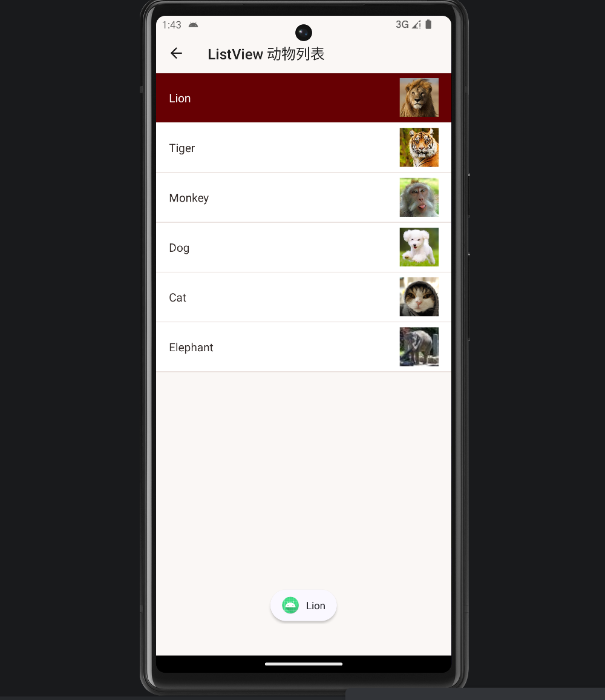
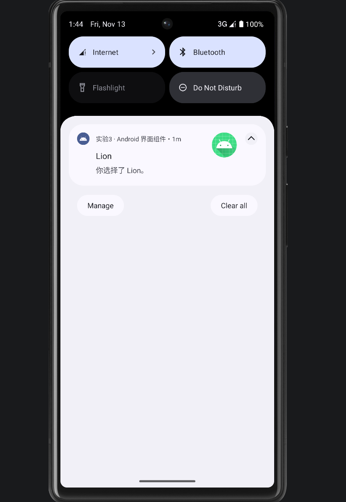
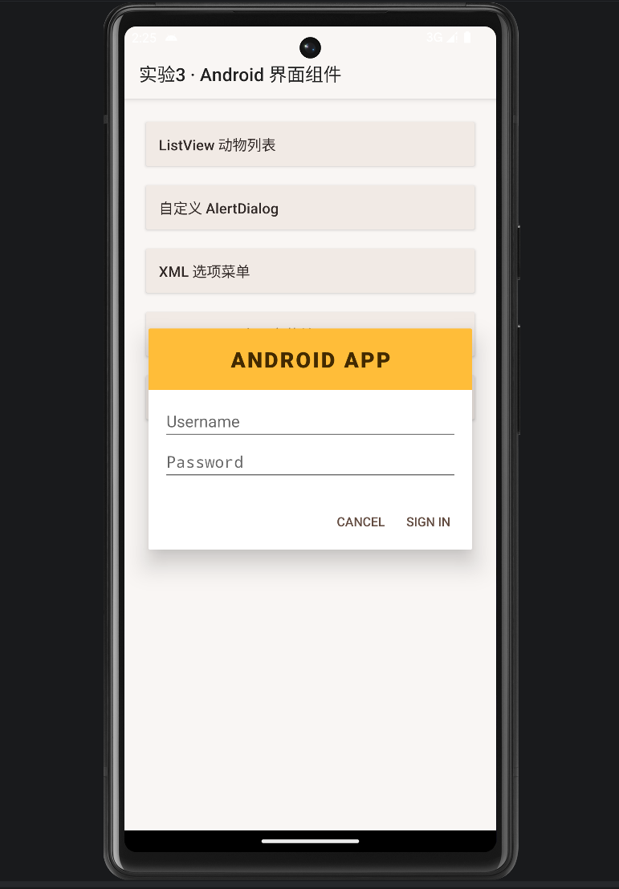
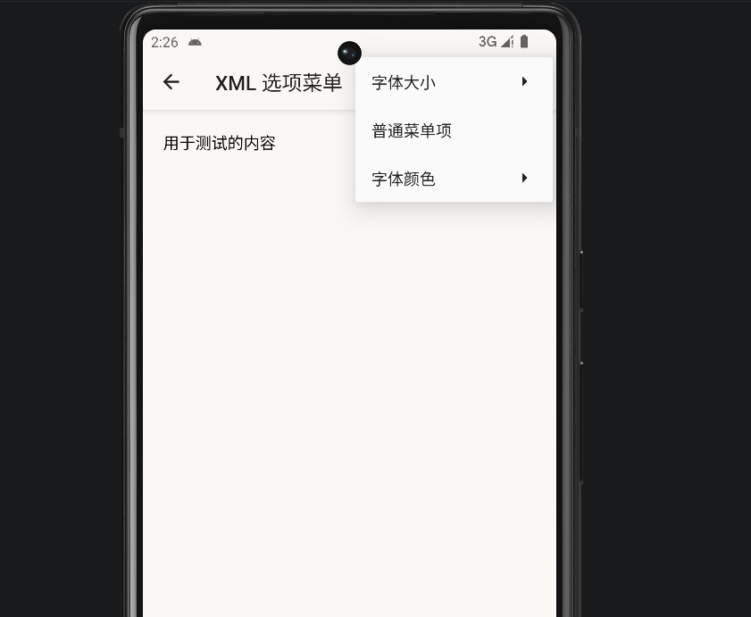
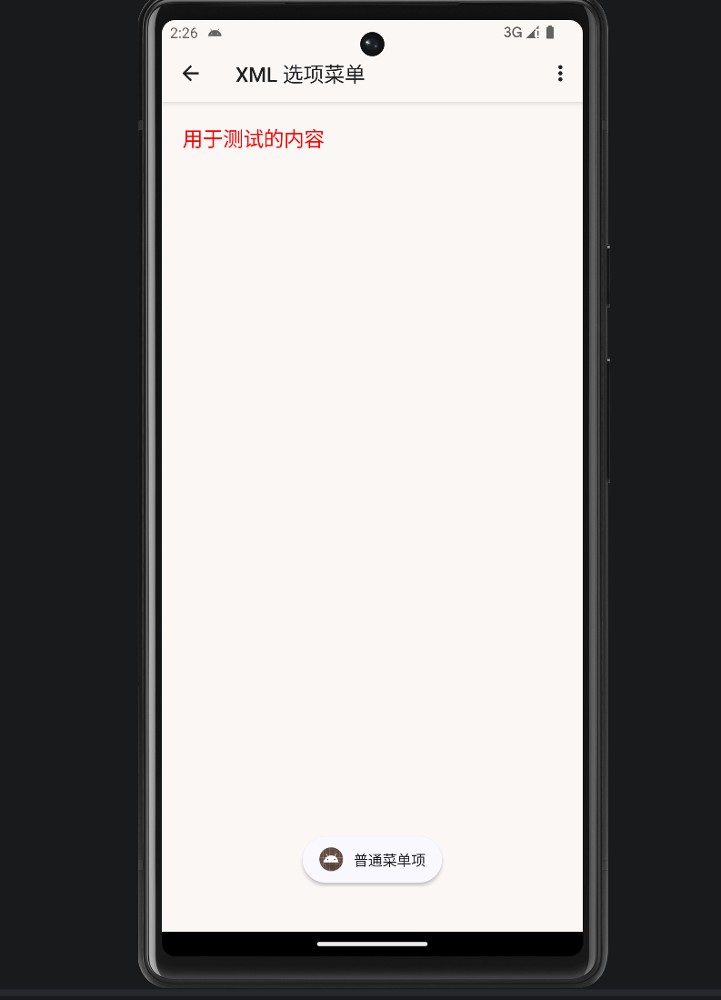
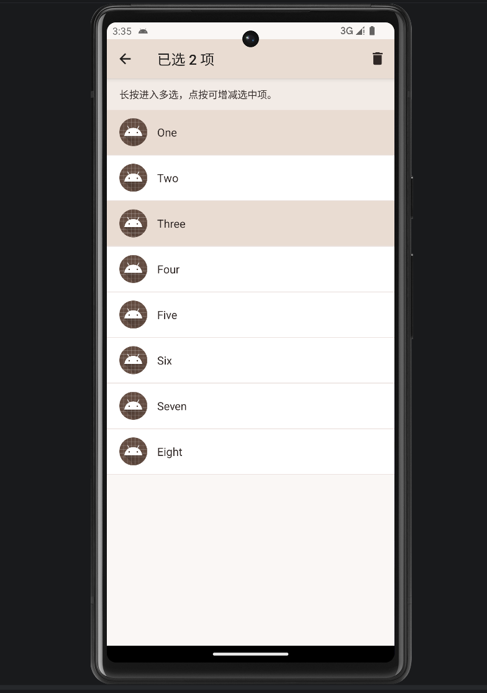
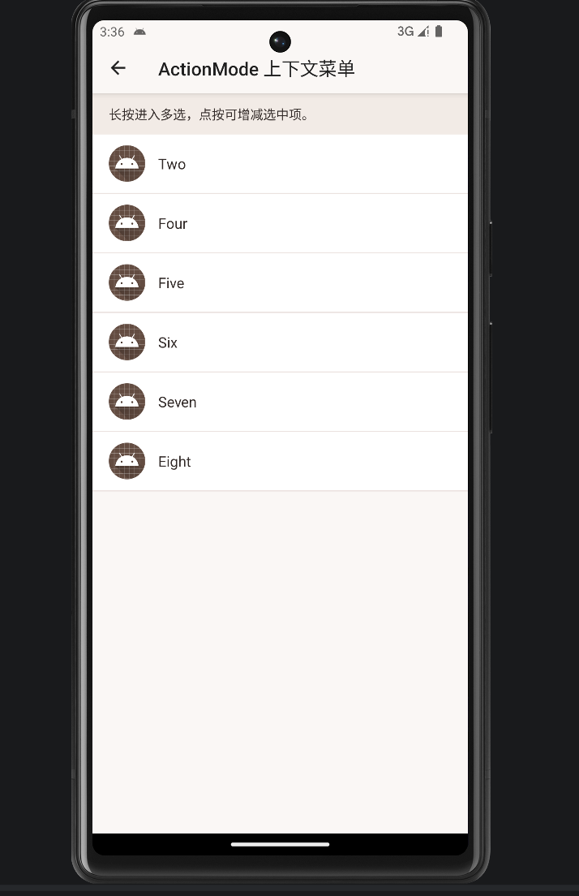
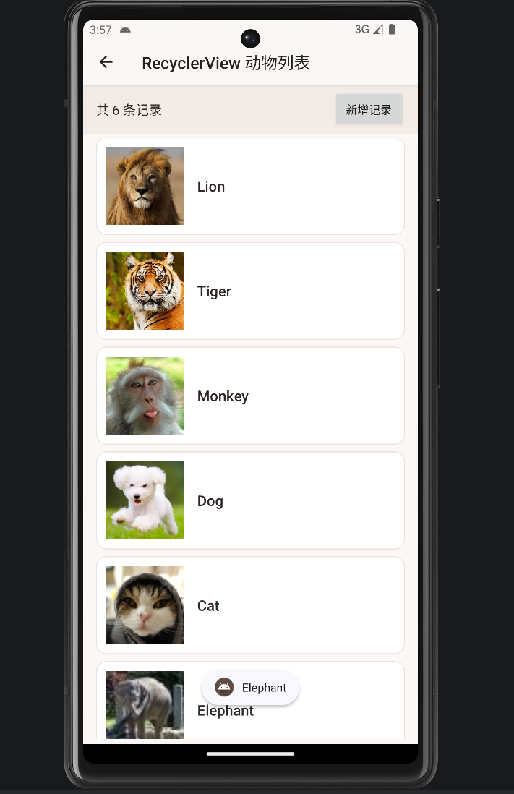
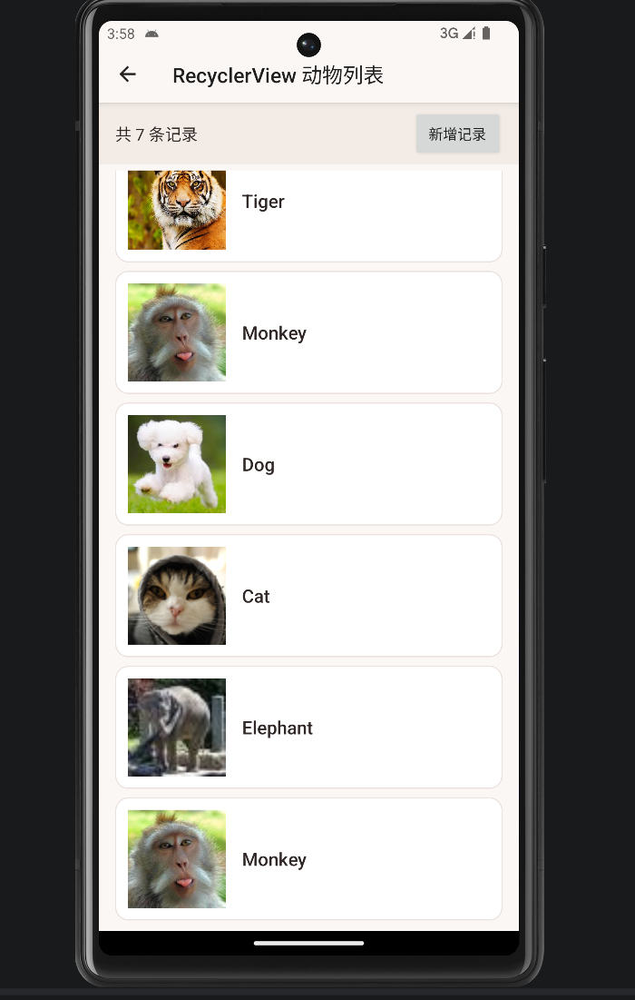

# 实验 3 · Android 界面组件实验报告

## 一、实验目的

1. 使用 `ListView` 和 `SimpleAdapter` 显示图文列表，处理列表项点击、Toast 和系统通知。
2. 使用 XML 编写自定义对话框布局和选项菜单，处理表单输入和菜单事件。
3. 使用 `ActionMode` 实现列表多选和批量删除。
4. 使用 `RecyclerView`、`Adapter` 和 `ViewHolder` 展示数据，验证滚动、点击和插入后的局部刷新。

## 二、实验环境

| 项目 | 配置 |
| --- | --- |
| 开发工具 | Android Studio |
| 开发语言 | Kotlin、XML |
| 界面技术 | Android Views、AndroidX RecyclerView |
| 构建环境 | JDK 21、Gradle 9.3.1、Android Gradle Plugin 9.1.1 |
| Android SDK | 编译 SDK 36.1，目标 API 36，最低 API 24 |
| 验证环境 | Pixel 6 模拟器，Android 14（API 34） |

在 Android Studio 中打开项目根目录，同步 Gradle 后运行 `app`，从首页进入对应练习。第一项需要查看系统通知，在首次弹出通知权限请求时选择「允许」。

## 三、实验内容与验收结果

### 3.1 ListView 动物列表

将配套素材包中的六张动物原图放入 `res/drawable-nodpi`，用 `Animal` 保存动物名称和图片资源 ID。`SimpleAdapter` 把名称和图片映射到列表行的 `TextView` 与 `ImageView`，行内左侧显示名称，右侧显示图片。列表采用单选模式，选中行显示深红色。

点击列表项时，`OnItemClickListener` 先用 Toast 显示动物名称，再发送系统通知。通知标题取自选中的动物名称，正文为「你选择了 <动物名称>。」。通知卡片使用应用图标，状态栏小图标使用同一图案的单色版。本实验选用的 Pixel 6 模拟器在授权后发送通知。

主要代码见 [AnimalListActivity.kt](app/src/main/java/com/example/exp_03_androidwidgets/AnimalListActivity.kt) 和 [列表项布局](app/src/main/res/layout/item_animal.xml)。

**验收结果**　点击 `Lion` 后，该行高亮，Toast 显示 `Lion`。下拉通知栏可以看到应用图标、标题 `Lion` 和正文「你选择了 Lion。」。

### 3.2 自定义 AlertDialog

在 XML 中定义黄色 `ANDROID APP` 标题区及 `Username`、`Password` 输入框。使用 `LayoutInflater` 加载布局，通过 `AlertDialog.Builder.setView()` 将其加入对话框，并配置 `Cancel` 和 `Sign in` 按钮。`Sign in` 触发本地表单校验，密码框使用掩码显示。

主要代码见 [MainActivity.kt](app/src/main/java/com/example/exp_03_androidwidgets/MainActivity.kt) 和 [对话框布局](app/src/main/res/layout/dialog_sign_in.xml)。

**验收结果**　打开对话框后可看到标题、两个输入框和底部按钮。提交空表单时显示必填提示，弹窗保持打开。填写两项后提交，弹窗关闭并显示「登录表单已提交」。点击 `Cancel` 可直接关闭弹窗。

### 3.3 XML 选项菜单

在 `res/menu/text_options.xml` 中定义「字体大小」「普通菜单项」「字体颜色」。`onCreateOptionsMenu()` 使用 `MenuInflater` 加载菜单，`onOptionsItemSelected()` 根据菜单项 ID 更新测试文本或弹出 Toast。字体大小子菜单提供 10、16、20 sp，字体颜色子菜单提供红色和黑色。

主要代码见 [MenuActivity.kt](app/src/main/java/com/example/exp_03_androidwidgets/MenuActivity.kt) 和 [选项菜单 XML](app/src/main/res/menu/text_options.xml)。

**验收结果**　右上角菜单可展开，字号和颜色随选项改变。将字号设为大（20 sp）、颜色设为红色，再点击「普通菜单项」，页面同时显示放大的红色文本和对应的 Toast。

### 3.4 ActionMode 上下文菜单

`ListView` 使用 `CHOICE_MODE_MULTIPLE_MODAL` 和 `MultiChoiceModeListener`。长按列表项会进入 `ActionMode` 并加载删除菜单，点按其他行可增减选中项，顶部标题随选中数量变化。点击删除时，按位置从大到小移除已选条目，避免删除时下标偏移，随后调用 `notifyDataSetChanged()` 刷新列表。

主要代码见 [SelectionActivity.kt](app/src/main/java/com/example/exp_03_androidwidgets/SelectionActivity.kt) 和 [上下文菜单 XML](app/src/main/res/menu/selection_actions.xml)。

**验收结果**　长按 `One` 后再点 `Three`，两行高亮，顶部显示「已选 2 项」和删除图标。点击删除后，两条记录消失，其他记录 保留，顶部恢复普通标题栏。

### 3.5 RecyclerView 动物列表

`RecyclerView` 使用 `LinearLayoutManager` 纵向排列条目，复用第一项的六张动物原图。`AnimalAdapter` 创建 `AnimalViewHolder`，并在每次绑定时同步设置图片、名称和点击回调。点击「新增记录」并选择动物后，将记录追加到数据末尾，调用 `notifyItemInserted()` 刷新插入位置，更新记录数并滚动到新行。

主要代码见 [AnimalRecyclerActivity.kt](app/src/main/java/com/example/exp_03_androidwidgets/AnimalRecyclerActivity.kt) 和 [列表项布局](app/src/main/res/layout/item_recycler_animal.xml)。

**验收结果**　初始显示 6 条记录，滚动后点击 `Elephant`，Toast 显示 `Elephant`。新增 `Monkey` 后记录数立即变为 7，末尾出现对应的猴子图片和名称。来回滚动后再点击新行，Toast 显示 `Monkey`，图片和名称仍对应。

## 四、实验总结

`SimpleAdapter` 通过键和视图 ID 的对应关系完成图文绑定。`RecyclerView` 的行视图会被复用，因此每次绑定都要更新图片、名称和点击回调，保证滚动后显示和操作的是同一条记录。批量删除先收集选中位置再从后往前移除，单条插入则通过 `notifyItemInserted()` 告知适配器具体的变更位置。

选项菜单适用于修改页面上的测试文本，`ActionMode` 将删除操作放在列表项选中后出现的操作栏里。自定义对话框通过 `setView()` 复用 XML 布局，通知则需要同时处理通知渠道和运行时权限。
